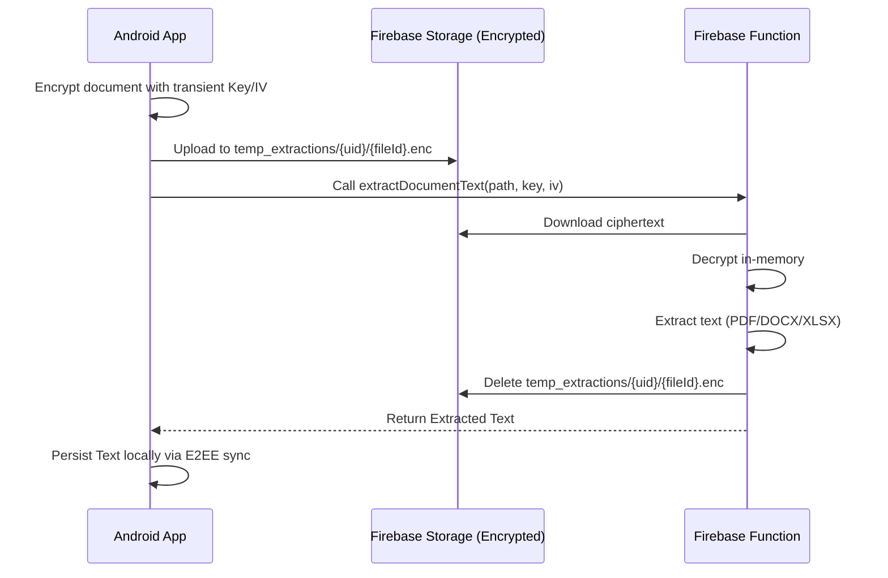

# Design Spec: Secure Cloud Document Extraction

**Status:** Draft
**Date:** 2026-05-09
**Author:** Gemini CLI

## 1. Problem Statement
The application currently only supports plaintext file attachments. Users want to attach complex document formats (PDF, DOCX, XLSX). Parsing these on-device would significantly increase the app's binary size and resource consumption.

## 2. Goals
- Support text extraction from PDF, DOCX, and XLSX files.
- Maintain **Zero-Knowledge Privacy** (server never sees unencrypted data without a transient key).
- No long-term storage of unencrypted files on the server.
- Leverage existing E2EE persistence and sync for rehydration.

## 3. Architecture

### 3.1. Overview
We will implement a hybrid cloud-parsing workflow where the client handles encryption and the server handles transient extraction.

### 3.2. Components

#### A. Firebase Function (`extractDocumentText`)
- **Runtime:** Node.js 20 (TypeScript)
- **Libraries:**
    - `pdf-parse`: For PDF extraction.
    - `mammoth`: For Word (DOCX) extraction.
    - `xlsx`: For Excel (XLSX) extraction.
    - `crypto`: For AES-256-GCM decryption.
- **Protocol:**
    1. Validate Firebase Auth context.
    2. Download encrypted file from path.
    3. Decrypt using provided Key/IV.
    4. Detect format by extension/magic bytes.
    5. Extract text.
    6. Delete source file from Storage.
    7. Return JSON: `{ text: string, error?: string }`.

#### B. Domain Layer (Android)
- **`CloudDocumentExtractorPort`**: New interface for cloud-based extraction.
- **`ProcessFileAttachmentUseCase`**: Update to route by MIME type.
    - `text/*` -> Local Read.
    - `application/pdf`, `...vnd.openxmlformats-officedocument...` -> `CloudDocumentExtractorPort`.

#### C. Data Layer (Android)
- **`FirebaseCloudDocumentExtractor`**:
    - Implementation of the port.
    - Uses `FirebaseStorage` and `FirebaseFunctions` SDKs.
    - Uses `CryptoManagerPort` for encryption.

## 4. Security Implementation
- **Transient Keys:** A unique AES-256 key is generated for *each* extraction request.
- **Storage Protection:** Files are stored in a dedicated `temp_extractions` folder with strict Security Rules (write-only for owner, read-only for nobody, deleted by function).
- **Cleanup:** The function deletes the file as its last step. A scheduled cleanup function (existing in `scheduledCleanup.ts`) will be updated to purge any abandoned temp files older than 1 hour.

## 5. Persistence and Sync
- Extracted text is returned to the UI and then saved to the `message_file` table via `MessageRepository`.
- The existing `MessageFileCloudSyncWorker` will handle permanent E2EE storage of the *extracted text*, ensuring rehydration works across devices without needing the original binary document.

## 6. Testing Strategy
- **Unit Tests:**
    - Mocked encryption/decryption loop.
    - Use case routing logic.
- **Integration Tests:**
    - Test function with sample PDF/DOCX/XLSX.
- **E2E Tests:**
    - Attach a PDF in the UI and verify text appears in the input bar.
