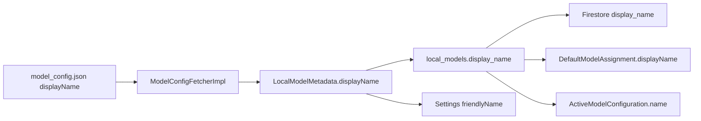

# FEAT-local-model-asset-display-name Spec

**Ticket ID:** `FEAT-local-model-asset-display-name`

## Feature Summary

Introduce a **file-level** human-readable `displayName` on each LLM asset in `model_config.json`, persist it through the download/registry pipeline into Room (`local_models.display_name`), sync it to Firestore, and use it everywhere the UI previously showed the Hugging Face repo string or the configuration preset name as the “model” label.

**Problem (verified):**

- Root `model_config.json` assets have `huggingFaceModelName` and per-preset `configurations[].displayName` (e.g. `"Gemma 4 E4B (Fast)"`), but **no asset-level** `displayName`.
- `DefaultModelRepositoryImpl.resolveAssignment` sets `displayName = model?.huggingFaceModelName` for local defaults (line 89).
- `DefaultModelsDao.observeAllWithDetails` selects `lm.huggingface_model_name as localAssetName`.
- `ActiveModelProviderImpl` sets `ActiveModelConfiguration.name` from **decrypted config** `displayName`, so `GetModelDisplayNameUseCase` → `EngineLoadingIndicator` shows the preset label (e.g. `"Fast"`) instead of the model family name.
- `LocalModelAssetUiMapper` derives `friendlyName` by parsing `metadata.huggingFaceModelName`.
- `PrepareModelDeletionUseCase` uses `asset.metadata.huggingFaceModelName` for reassignment `assetDisplayName`.

**Target UX:**

| Surface | Shows |
| --- | --- |
| Settings → Model Role Assignments (`currentModelName`) | Asset `displayName` (e.g. `"Gemma 4 E4B"`) |
| Settings → assignment subtitle (`presetName`) | Preset `displayName` role label only (e.g. `"Fast"`) |
| Chat `EngineLoadingIndicator` / `GetModelDisplayNameUseCase` | Asset `displayName` |
| Local models sheet / config screen (`friendlyName`) | Asset `displayName` |
| Deletion reassignment picker (local) | Asset `displayName` |

Preset `configurations[].displayName` remains on `LocalModelConfiguration` for encrypted preset storage and `"Preset: …"` subtitles; only the **asset** label source changes.

**Out of scope:** Utility assets (`utilityType` set, empty `configurations`) stay on `utility_models`; no asset `displayName` in JSON for whisper/onnx rows. `ModelDownloadWorker` unchanged (parses `DownloadFileSpec` only).

---

## Authoritative `model_config.json` Edits (LLM assets only)

Add `"displayName"` on each LLM asset object. Shorten each preset `displayName` to the role label (text inside former parentheses, or `ModelType.displayName()` when there was no suffix).

| `sha256` (prefix) | Asset `displayName` | Config `configId` (suffix) | Preset `displayName` (new) |
| --- | --- | --- | --- |
| `1cfadbb7…` | `MiniCPM-V-4.6 1.3B` | `…440002` | `Analytic Drafter` |
| `fd6cad5e…` | `Qwen 3.5 2B` | `…440003` | `Draft Two` |
| `a6ce2452…` | `Jamba Reasoning 3B` | `…440004` | `Synthesis` |
| `0b2a8980…` (Gemma file) | `Gemma 4 E4B` | `…440006` | `Fast` |
| same | same | `…440007` | `Thinking` |
| same | same | `…440005` | `Final Synthesis` |

Utility rows (`ggerganov/whisper.cpp`, `all-MiniLM-L6-v2`) — **no** asset `displayName` field.

---

## File Structure Table

| File | Action | Responsibility |
| --- | --- | --- |
| `plans/FEAT-local-model-asset-display-name/spec.md` | Create | Implementation contract (this file). |
| `plans/FEAT-local-model-asset-display-name/test_spec.md` | Create | Gherkin scenarios and run commands. |
| `model_config.json` | Modify | Asset `displayName` + shortened preset labels for all LLM assets. |
| `core/domain/.../model/config/RemoteModelConfig.kt` | Modify | Add `displayName` to `RemoteModelAsset`. |
| `core/domain/.../model/config/LocalModelMetadata.kt` | Modify | Add `displayName: String`. |
| `core/domain/.../mapper/ModelConfigMapper.kt` | Modify | `ModelFile.displayName` from asset `displayName`, not first preset. |
| `core/domain/.../usecase/settings/PrepareModelDeletionUseCase.kt` | Modify | `assetDisplayName = asset.metadata.displayName`. |
| `core/data/.../local/LocalModelEntity.kt` | Modify | Column `display_name`. |
| `core/data/.../local/EnclaveDatabase.kt` | Modify | Version `7` → `8`. |
| `core/data/.../local/EnclaveDatabaseMigrations.kt` | Modify | `MIGRATION_7_8` adds column + HF backfill. |
| `core/data/schemas/.../EnclaveDatabase/8.json` | Create | Exported Room schema (KSP after implementation). |
| `core/data/.../DataModule.kt` | Modify | Register `MIGRATION_7_8`. |
| `core/data/.../download/ModelConfigFetcherImpl.kt` | Modify | Map asset `displayName`; validate non-utility LLM assets. |
| `core/data/.../repository/LocalModelRepositoryImpl.kt` | Modify | Persist/map `displayName` in upsert, save, entityToMetadata. |
| `core/data/.../repository/DefaultModelRepositoryImpl.kt` | Modify | `displayName = model?.displayName` in `resolveAssignment`. |
| `core/data/.../local/DefaultModelsDao.kt` | Modify | SQL: `lm.display_name as localAssetName`. |
| `core/data/.../repository/ActiveModelProviderImpl.kt` | Modify | `name = model.displayName` for local configs. |
| `core/data/.../remote/firestore/handlers/LocalModelSyncHandler.kt` | Modify | Firestore field `display_name` round-trip. |
| `feature/settings/.../SettingsUiMappers.kt` | Modify | `LocalModelAssetUiMapper.friendlyName` from `metadata.displayName`. |
| `core/domain/src/test/.../testing/Fakes.kt` | Modify | `createFakeLocalModelAsset` accepts `displayName`. |
| `app/src/test/.../testing/Fakes.kt` | Modify | Fake local model metadata includes `displayName`. |
| `core/testing/.../FakeLocalModelRepository.kt` | Modify | Preserve `displayName` in stored metadata if touched. |
| `core/data/src/test/.../download/ModelConfigFetcherImplTest.kt` | Modify | Asset displayName mapping + validation. |
| `core/data/src/test/.../local/LocalModelsDaoTest.kt` | Modify | Round-trip `display_name`. |
| `core/data/src/test/.../local/DefaultModelsDaoTest.kt` | Modify | `observeAllWithDetails` returns `display_name`. |
| `core/data/src/test/.../local/EnclaveDatabaseMigrationTest.kt` | Modify | Version 8 column + backfill. |
| `core/data/src/test/.../repository/DefaultModelRepositoryImplTest.kt` | Modify | Local assignment uses asset display name. |
| `core/data/src/test/.../repository/ActiveModelProviderImplTest.kt` | Modify | `name` is asset display name. |
| `core/data/src/test/.../repository/LocalModelRepositoryImplTest.kt` | Modify | Upsert/read `displayName`. |
| `core/data/src/test/.../remote/firestore/LocalModelSyncHandlerTest.kt` | Create | Firestore `display_name` sync. |
| `core/data/src/test/.../download/DownloadFinalizeWorkerTest.kt` | Modify | Finalize persists asset `displayName` from catalog. |
| `core/domain/src/test/.../usecase/chat/GetModelDisplayNameUseCaseTest.kt` | Modify | Returns asset display name via provider. |
| `core/domain/src/test/.../usecase/settings/PrepareModelDeletionUseCaseTest.kt` | Modify | Reassignment uses `metadata.displayName`. |
| `feature/settings/src/test/.../SettingsUiStateFactoryTest.kt` | Modify | `friendlyName` from metadata `displayName`. |

**Not modified (verified):**

- `core/data/.../download/ModelDownloadWorker.kt` — uses `DownloadFileSpec` JSON only; no model metadata.
- `core/data/.../download/DownloadFinalizeWorker.kt` — indirect via `ModelConfigFetcherPort` + `SyncLocalModelRegistryUseCase`; no worker code change unless tests require fixture updates.
- `LocalModelConfigurationEntity` / encrypted preset `display_name` — unchanged semantics (role label).

---

## API Contracts

### JSON / kotlinx.serialization — `RemoteModelAsset`

```kotlin
@Serializable
data class RemoteModelAsset(
    val huggingFaceModelName: String = "",
    val displayName: String = "",  // NEW — required for non-utility LLM assets in shipped config
    // ... existing fields unchanged ...
)
```

JSON key: `"displayName"` (camelCase, matches existing config style).

### Domain — `LocalModelMetadata`

```kotlin
data class LocalModelMetadata(
    val id: LocalModelId,
    val displayName: String,  // NEW — non-empty for catalog-backed LLM assets
    val huggingFaceModelName: String,
    // ... existing fields ...
)
```

**Invariant:** For assets synced from remote catalog with `utilityType == null` and non-empty `configurations`, `displayName` must be non-blank before Room upsert.

### Room — `LocalModelEntity`

```kotlin
@ColumnInfo(name = "display_name")
val displayName: String,
```

Table: `local_models`. Column is **not** encrypted (same class as `huggingface_model_name`).

### Migration `MIGRATION_7_8`

```kotlin
val MIGRATION_7_8 = Migration(7, 8) { db ->
    db.execSQL(
        "ALTER TABLE local_models ADD COLUMN display_name TEXT NOT NULL DEFAULT ''",
    )
    db.execSQL(
        "UPDATE local_models SET display_name = huggingface_model_name WHERE display_name = ''",
    )
}
```

`EnclaveDatabase.version = 8`. Register in `DataModule` alongside existing migrations. `fallbackToDestructiveMigration(dropAllTables = true)` remains as safety net.

### `ModelConfigFetcherImpl`

- `toLocalModelAssets`: set `LocalModelMetadata.displayName = asset.displayName`.
- `validateAsset` (non-utility): `require(asset.displayName.isNotBlank()) { "Non-utility asset ${asset.fileName} must declare displayName." }`.
- Utility branch unchanged (no `displayName` requirement).

### `LocalModelRepositoryImpl`

Map `displayName` in:

- `upsertLocalAsset`
- `saveLocalModelMetadata`
- `entityToMetadata`

### `DefaultModelRepositoryImpl`

```kotlin
displayName = model?.displayName  // was huggingFaceModelName
```

`DefaultModelAssignmentView.localAssetName` continues as the Kotlin property name; SQL alias becomes `lm.display_name as localAssetName`.

### `ActiveModelProviderImpl` (local branch)

```kotlin
name = model.displayName  // was decryptRequired(config.displayName, ...)
```

API/TTS/media branches unchanged.

### Firestore — `LocalModelSyncHandler`

- `toFirestore`: add `"display_name" to local.displayName`.
- `fromFirestore`: `displayName = doc.getString("display_name") ?: ""`.
- Missing remote field on older documents: treat as `""`; next local upsert from catalog overwrites.

### `LocalModelAssetUiMapper`

```kotlin
friendlyName = asset.metadata.displayName.ifBlank {
    /* existing HF repo parsing fallback for legacy rows only */
}
```

Prefer requiring non-blank from DB for catalog assets; fallback keeps Robolectric tests with HF-only fixtures from breaking before migration backfill runs.

### `ModelConfigMapper`

```kotlin
displayName = asset.displayName.ifBlank { asset.fileName },
```

Remove dependence on `primaryConfig?.displayName` for the file-level label.

### `PrepareModelDeletionUseCase`

```kotlin
assetDisplayName = asset.metadata.displayName,
```

---

## Data Flow



---

## Ordered Implementation Tasks

### Task 1 — Catalog and domain types

Update `model_config.json` per the authoritative table above.

Add `displayName` to `RemoteModelAsset` and `LocalModelMetadata`.

**Scenarios:** SCN-JSON-001, SCN-DOMAIN-001, SCN-FETCH-001, SCN-FETCH-002, SCN-MUT-001

### Task 2 — Room schema v8

Add `displayName` to `LocalModelEntity`, bump `EnclaveDatabase` to 8, implement `MIGRATION_7_8`, register in `DataModule`, run KSP to emit `schemas/.../EnclaveDatabase/8.json`.

**Scenarios:** SCN-SCHEMA-001, SCN-MIGRATION-001, SCN-DAO-001

### Task 3 — Fetcher and repository persistence

Wire `ModelConfigFetcherImpl` mapping + validation.

Wire `LocalModelRepositoryImpl` upsert/save/load paths.

**Scenarios:** SCN-FETCH-001, SCN-FETCH-002, SCN-FETCH-003, SCN-REPO-001, SCN-FINALIZE-001, SCN-MUT-001

### Task 4 — Default model assignment resolution

Update `DefaultModelsDao` SQL and `DefaultModelRepositoryImpl.resolveAssignment`.

**Scenarios:** SCN-DAO-002, SCN-REPO-DEFAULT-001, SCN-REPO-DEFAULT-002, SCN-MUT-002

### Task 5 — Active model display name (chat loading)

Update `ActiveModelProviderImpl` local branch to use asset `displayName`.

**Scenarios:** SCN-ACTIVE-001, SCN-USECASE-001, SCN-MUT-003

### Task 6 — Firestore sync

Update `LocalModelSyncHandler`; add `LocalModelSyncHandlerTest`.

**Scenarios:** SCN-SYNC-001, SCN-SYNC-002, SCN-SYNC-003

### Task 7 — Settings and deletion UI mappers

Update `LocalModelAssetUiMapper`, `PrepareModelDeletionUseCase`, `ModelConfigMapper`.

**Scenarios:** SCN-UI-001, SCN-UI-002, SCN-DELETION-001, SCN-MAPPER-001

### Task 8 — Test fixtures and fakes

Update `createFakeLocalModelAsset`, app/domain fakes, `FakeLocalModelRepository`, and all tests listed in the file table so compile and assert new literals.

**Scenarios:** All scenario IDs in `test_spec.md`.

### Task 9 — Validation gate

Run focused Gradle commands from `test_spec.md`, then `:core:data:ktlintCheck` and `./gradlew detekt` on touched modules.

**Scenarios:** (execution only)

---

## Drift And Escalation Rules

- **Approved behavior:** Asset-level name everywhere the user sees “which model file”; preset name only for preset/role lines. Do not reintroduce HF repo string or combined `"Model (Role)"` strings in preset `displayName`.
- **Schema:** Only `local_models.display_name` is authorized; do not add columns elsewhere without a new contract waiver.
- **Encryption:** `display_name` on `local_models` is plaintext at rest, like `huggingface_model_name`. Do not add to `SensitiveFieldCatalog`.
- **If Red phase tests need `EngineLoadingIndicator` composable tests:** keep them in `feature/chat` only if product requests; this ticket’s contract is satisfied by `GetModelDisplayNameUseCase` + `ActiveModelProviderImpl` unit tests.
- **If remote Firestore documents lack `display_name`:** local HF backfill from migration is acceptable until catalog sync; do not fetch HF string in UI when `display_name` is non-blank.
- **Escalate to human:** Any request to show combined `"Gemma 4 E4B (Fast)"` in `EngineLoadingIndicator` or role assignments (regression against this spec).

---

## Self-Review Checklist

- [x] Every requirement has implementation tasks and matching scenarios in `test_spec.md`.
- [x] Every behavior-changing task lists scenario IDs.
- [x] File paths verified in repository.
- [x] `ModelDownloadWorker` explicitly excluded with rationale.
- [x] Literal JSON values documented (no placeholders).
- [x] Mutation scenarios target HF-string and config-name lazy implementations.
