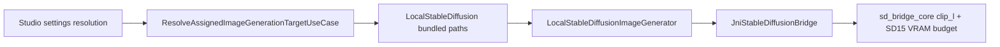

# Spec: Stable Diffusion 1.5 Local T2I (replace Bonsai)

**Ticket ID:** `sd15-t2i`  
**Date:** 2026-06-04  
**Status:** Approved (user pre-approved in chat)  
**Contracts read:** `ARCHITECTURE_RULES.md`, `INFERENCE_RULES.md`, `DATA_LAYER_RULES.md`, `CODE_STYLE_RULES.md`, `UNIT_TESTING.md`

---

## 1. Feature Summary

Replace the on-device **Bonsai Flux.2 Klein** pack (~5.5 GB, Qwen3 + Flux VAE, 4-step) with a **single bundled SD 1.5 GGUF** (~1.65 GB) suitable for Adreno Vulkan mobile offload.

### Goals

| Goal | Target |
|------|--------|
| Quality / stability | No `DeviceLost`, no system UI soft-reboot during 512² generation |
| Latency | ≤ ~4 min at 512² / 20 steps (tune toward ~3 min on Razr Fold class devices) |
| Resolutions | **512×512** and **1024×1024** (UI already drives `imageResolution`; capabilities must advertise both) |
| Pack UX | One pack row `sd15-t2i`, **1/1** member when complete |

### Pinned artifact (Phase 0 — verified 2026-06-04)

| Field | Value |
|-------|--------|
| Repo | `gpustack/stable-diffusion-v1-5-GGUF` |
| File | `stable-diffusion-v1-5-Q4_0.gguf` |
| SHA-256 | `c2f6e92f9d08d69cc673a1003528ac8199274b3c0eaec88d5fbefe5af67bd42b` |
| sizeInBytes | `1747190784` |
| Contents | UNet Q4_0 + CLIP ViT-L/14 FP16 + VAE FP16 (single GGUF) |

### Runtime defaults (Kotlin → JNI)

| Parameter | Value |
|-----------|--------|
| steps | 20 |
| cfg | 7.5 |
| sampler | `euler` |
| diffusion_flash_attn | false |
| offload_params_to_cpu | true |
| Text encoder binding | `clip_l_path` (not `llm_path`) |
| VAE / CLIP paths | Same absolute path as bundled diffusion GGUF |
| max_vram (offload) | 1.5 GiB |
| stream_layers | false |
| keep_clip_on_cpu / keep_vae_on_cpu | true |

### Non-goals

- Keeping Bonsai / Flux2 / Qwen3 catalog rows or dual-stack selection UI
- New Room schema columns
- Cloud BYOK changes

---

## 2. Architecture

- Domain identifies pack/diffusion via `LocalStableDiffusionModelPolicy` SHA pin.
- Single-member `sd15-t2i` pack; completeness **1/1**.
- Inference maps bundled file to diffusion + VAE + `clip_l` paths.

---

## 3. File change table

| Path | Action |
|------|--------|
| `model_config.json` | Replace Bonsai asset; remove Flux2/Qwen companions; `sd15-t2i` pack (1 member) |
| `core/domain/.../ImageGenerationTarget.kt` | SD15 SHA policy; capabilities `512x512`, `1024x1024` |
| `core/domain/.../SynthesizeImageGenerationPack.kt` | `FALLBACK_PACK_ID = sd15-t2i`; single-member synthesis |
| `core/domain/.../ImageGenerationPackMemberFilter.kt` | Drop Flux/Qwen companion filter |
| `core/domain/.../ResolveAssignedImageGenerationTargetUseCase.kt` | Bundled path resolution; generic errors |
| `core/domain/.../SetDefaultModelUseCase.kt` | Generic pack incomplete message |
| `stable-diffusion-android/.../sd_bridge_core.*` | `clip_l_path`, SD15 VRAM tuning |
| `stable-diffusion-android/.../stable_diffusion_jni.cpp` | `useClipLTextEncoder` JNI flag |
| `stable-diffusion-android/.../NativeStableDiffusionParams.kt` | `useClipLTextEncoder` |
| `feature/inference/.../LocalStableDiffusionImageGenerator.kt` | SD15 defaults; pass clip flag |
| `feature/inference/.../StableDiffusionRequest` | `useClipLTextEncoder` field |
| Tests / fixtures | Bonsai → SD15 red tests and `ModelPackTestFixtures` |

---

## 4. Acceptance criteria

1. Catalog downloads one HF GGUF; settings shows **Stable Diffusion 1.5** pack **1/1**.
2. Local assign blocked until pack complete; succeeds when file verified.
3. Studio exposes resolutions **512×512** and **1024×1024**; invalid selections clamp per existing coordinator.
4. Generation request uses steps=20, cfg=7.5, `useClipLTextEncoder=true`, bundled paths.
5. Unit tests + `:stable-diffusion-android` host tests + affected module `testDebugUnitTest` pass.
6. `detekt` / `ktlintCheck` clean for touched modules.

---

## 5. PR stack (logical)

1. Plan + pinned SHA (this doc)
2. `model_config.json` + catalog tests
3. Domain policy / pack / resolve / capabilities
4. Native bridge `clip_l` + VRAM
5. Inference Kotlin defaults
6. Test renames and fixture migration