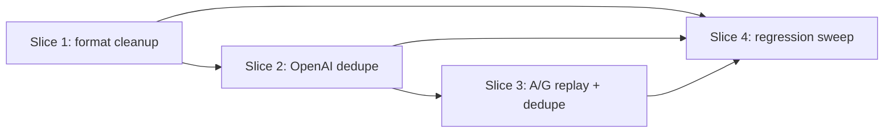

# Structure: sidecar-dedupe-model-wire

Vertical-slice execution outline for human approval before Plan and TDD Red. Signatures and checkpoints only — no algorithm bodies.

**Grounding:** `ticket.md`, `research.md`, `design.md` (approved 2026-06-17). Decisions D1–D10, OQ-1 (C), OQ-2, OQ-3 are frozen.

---

## Slice index

| # | Goal |
|---|------|
| **1** | Emit model-only sidecar text (no engine noise) with updated format tests |
| **2** | Ship sidecar only when string changed on OpenAI-family wire + conditional freeze |
| **3** | Anthropic/Google dedupe gate + **index-interleaved** frozen replay (`SessionIndexVolatilePlacement`) |
| **4** | Volatile-detection alignment and full inference-module regression sweep |

---

## Dependencies between slices

| Slice | Must land before |
|-------|------------------|
| 1 | 2, 3, 4 |
| 2 | 3, 4 |
| 3 | 4 |
| 4 | — (terminal) |

**Rationale:** Dedupe equality (Slice 2+) compares strings produced by cleaned builder (Slice 1). A/G replay (Slice 3) reuses `resolveContextSidecarsForWire` from Slice 2. Slice 4 validates cross-provider expectations after all wire paths change.

---

## Public contracts

### New / changed domain-adjacent types (`:feature:inference`)

| Symbol | Location | Shape |
|--------|----------|-------|
| `lastShippedSidecarText` | `ProviderAppendOnlyContext` (private field) | `String?`; `null` until first ship |
| `resolveContextSidecarsForWire` | `ProviderAppendOnlyContext` | `fun resolveContextSidecarsForWire(built: String?): String?` |

**`resolveContextSidecarsForWire` contract (D1):**

- Input `built`: output of `buildContextSidecars` (may be `null`).
- Returns non-null only when `built` is non-blank **and** `built != lastShippedSidecarText`.
- On non-null return: sets `lastShippedSidecarText = built`.
- On null return (unchanged or blank built): does not mutate `lastShippedSidecarText`.
- Caller gates live injection and freeze on non-null result only.

**Index-interleaved replay contract (D9 / OQ-1 C):**

- Reuse `SessionIndexVolatilePlacement.sidecarTextsBeforeSessionIndex(sessionIndex, frozenSidecars, preRetrieval, resolvedLive, tailInsertIndex)` when mapping each `AgentLoopMessage` row in Anthropic/Google wire builders.
- `frozenSidecars` = `appendOnly.frozenSidecarsForWireReplay()` on every hop (same list as OpenAI).
- `resolvedLive` = output of `resolveContextSidecarsForWire(built)`; null on dedupe skip.
- For message at session index `i`, prepend returned texts to that row's content only — **never** aggregate all frozen texts onto the latest user.
- `mappedInsertIndex` stored at freeze time is the session index (`SessionIndexVolatilePlacement.resolveTailInsertIndex` at freeze — already used by A/G today).

**Conceptual parity (all BYOK providers):**

| Behavior | OpenAI family | Anthropic / Google |
|----------|---------------|-------------------|
| Freeze | Only when resolved live sidecar is non-null (string changed) | Same |
| Unique snapshots | One frozen entry per distinct shipped string | Same |
| Unchanged hop | No new live sidecar, no new freeze; prior frozen snapshots still on wire | Same |
| Changed hop | Prior frozen replay at stored index + new live at tail index | Same |
| Wire mechanics | Interleave frozen as SYSTEM rows at `mappedInsertIndex` in mapped chat body | Interleave frozen as prepended text on the message row at `mappedInsertIndex` via `sidecarTextsBeforeSessionIndex` |

Dedupe/freeze gate is identical; placement primitive differs (SYSTEM interleave vs user-row prepend at fixed session index).

### Changed builder signatures (`RustLoopInferenceService`)

| Symbol | Change |
|--------|--------|
| `CONTEXT_REFERENCE_POLICY_PREAMBLE` | Append TTL line (OQ-2): `"Tool-output references expire after 2 user turns."` (or equivalent single line) |
| `buildContextSidecars` | Signature unchanged; drops `currentTurnIndex` parameter if no remaining callers |
| `formatContextReferenceLine` | `fun formatContextReferenceLine(reference: AgentContextReference): String` — no turn/freshness bracket |
| `parseTurnFromTitle` | Remove (wire formatting only) |
| `isStaleContextReference` | Remove (wire formatting only) |
| `logCacheHintsIfPresent` | `private fun logCacheHintsIfPresent(cacheHints: List<String>)` — DEBUG + `PROMPT_CACHE` tag (OQ-3) |

**`buildContextSidecars` return contract (D3, D5, D6):**

- Emits: preamble (with TTL), optional network status, optional reference lines, optional ledger/index JSON lines.
- Never emits: `Context management sidecars:`, `Cache hints:`, `|fresh|`, `|stale|`, `\|turn:N\|` bracket segment.
- Returns `null` when references, compacted JSON blobs, and network status are all absent (preamble alone does not force non-null).
- `cacheHints` excluded from emptiness calculation; not appended to returned string.

### Changed provider wire contracts

| Service | Call site change |
|---------|------------------|
| `BaseOpenAiSdkInferenceService.completeSingleTurn` | `val wireSidecar = appendOnly.resolveContextSidecarsForWire(contextSidecars)` before `buildMappedBodyWithSidecars`; pass `wireSidecar` as `currentSidecarText`; freeze only when `wireSidecar != null` |
| `AnthropicInferenceServiceImpl.completeSingleTurn` | Resolve live via `resolveContextSidecarsForWire`; per message index call `sidecarTextsBeforeSessionIndex(...)` and prepend to that row's text; freeze only when resolved live non-null |
| `GoogleInferenceServiceImpl.completeSingleTurn` | Same index-interleaved prepend in `mapAtIndex` / message loop |

**Unchanged contracts (explicit non-goals):**

- `AgentLoopHostCallbacks.completeModelTurn` / `ModelRequest.cacheHints` FFI path
- `endTurnFreezeSidecar` / `FrozenSidecarSnapshot` shape
- `frozenSidecarsForWireReplay()` + `OpenAiCompatibleVolatilePlacement` interleaving (OpenAI family)
- Pre-retrieval one-shot freeze path (`hasFrozenPreRetrievalSidecar`, `PreRetrievalContextSidecar`)
- `LlamaInferenceServiceImpl` (D10 — no `ProviderAppendOnlyContext`)

### Changed volatile-detection contracts (D8)

| Symbol | Change |
|--------|--------|
| `ChatCompletionMessageParam.isVolatileOrEngineSystemMessage` | Remove matchers for `Cache hints:`, `Context management sidecars:` |
| `AgentLoopMessage.isVolatileOrEngineSystemMessage` | Same removal |
| `XaiPromptCacheLiveContextTest.isVolatileSidecar` | Mirror production prefix set |

Retained matchers: pre-retrieval marker, `State ledger JSON:`, `Tool context index JSON:`, `File context index JSON:`, engine-internal, `[Conversation summary]`.

### Session reset contracts (D2)

| Method | Clears `lastShippedSidecarText` |
|--------|--------------------------------|
| `invalidate()` | yes (via extended `clearLogState` / inline clear) |
| `clearLogState(reason)` | yes |
| `markTurnBoundaryForReanchor()` | no |

---

## Per-slice checklist

### Slice 1 — Model-only sidecar format

**Goal:** Sidecar builder emits stable, model-facing prose; host `cacheHints` stays off the wire.

| Component | Action |
|-----------|--------|
| `RustLoopInferenceService.kt` | Rewrite `buildContextSidecars`, `formatContextReferenceLine`; extend preamble; add `logCacheHintsIfPresent`; remove stale/turn wire helpers |
| `RustLoopInferenceServiceTest.kt` | Update format assertions; add negative assertions (no header, cache hints, fresh/stale) |
| `XaiPromptCacheLiveContextTest.kt` | Sync duplicate `buildContextSidecars` helper with production shape |

**New/changed signatures:** builder contracts above; no `ProviderAppendOnlyContext` changes yet.

**Checkpoint:** `./gradlew :feature:inference:testDebugUnitTest --tests "*RustLoopInferenceServiceTest*"` passes; sidecar strings in tests match new format spec.

---

### Slice 2 — OpenAI-family dedupe gate

**Goal:** Identical built sidecar across hops → no live injection, no new freeze; OpenAI frozen replay preserves model visibility.

| Component | Action |
|-----------|--------|
| `ProviderAppendOnlyContext.kt` | Add `lastShippedSidecarText`, `resolveContextSidecarsForWire`; reset in `clearLogState` / `invalidate` |
| `ContextSidecarShipping.kt` (optional) | Co-locate pure resolve/reset helpers if `ProviderAppendOnlyContext` grows |
| `BaseOpenAiSdkInferenceService.kt` | Resolve before wire build; conditional `endTurnFreezeSidecar` |
| `ProviderAppendOnlyContextTest.kt` | Unit tests for resolve, reset-on-clear, unchanged-skip |
| `AppendOnlyOpenAiSidecarPlacementTest.kt` | SC-DEDUPE-01–04 scenarios on OpenAI wire |
| `XaiPromptCacheToolAndSessionStabilityTest.kt` | Adjust expectations where identical sidecar reduces freeze count |

**New signatures:** `resolveContextSidecarsForWire`, private `lastShippedSidecarText` field accessors via behavior tests.

**Checkpoint:** `./gradlew :feature:inference:testDebugUnitTest --tests "*ProviderAppendOnlyContextTest*" --tests "*AppendOnlyOpenAiSidecarPlacementTest*" --tests "*XaiPromptCacheToolAndSessionStabilityTest*"` passes; SC-DEDUPE-01–04 green on OpenAI path.

---

### Slice 3 — Anthropic/Google index-interleaved replay + dedupe

**Goal:** A/G share dedupe + freeze semantics with OpenAI; frozen snapshots replay at stored session index (not latest-user bundle).

| Component | Action |
|-----------|--------|
| `SessionIndexVolatilePlacement.kt` | Wire `sidecarTextsBeforeSessionIndex` into production (already implemented; add tests if gaps) |
| `AnthropicInferenceServiceImpl.kt` | Replace latest-user-only `combinedLatestUserPrepends` with per-index `sidecarTextsBeforeSessionIndex`; resolve live via dedupe gate |
| `GoogleInferenceServiceImpl.kt` | Replace `latestUserPrepends` with per-index sidecar prepend in `mapAtIndex` |
| `PromptCachingTest.kt` | Update A/G expectations: frozen sidecar text stays on the row at freeze index; latest row gets live only when changed |
| New or extended test class | A/G: 3 hops identical sidecar → 1 freeze; hop 2–3 prefix bytes at freeze index unchanged; no sidecar text migration to latest user |

**New signatures:** none beyond D1 resolve gate; reuse existing `sidecarTextsBeforeSessionIndex`.

**Checkpoint:** `./gradlew :feature:inference:testDebugUnitTest --tests "*PromptCachingTest*"` passes; A/G interleave + dedupe scenarios green. **Note:** `AOC-07`/`AOC-08` literal "prepend only on latest user" expectations must be revised — interleave replaces that regression baseline.

---

### Slice 4 — Volatile detection + module regression

**Goal:** Stable-system detection matches new sidecar shape; all prompt-cache and append-only tests aligned.

| Component | Action |
|-----------|--------|
| `BaseOpenAiSdkInferenceService.kt` | Update `isVolatileOrEngineSystemMessage` prefix set (D8) |
| `XaiPromptCacheLiveContextTest.kt` | Update `isVolatileSidecar` duplicate |
| `PromptCachingTest.kt` | PC-01–08 synthetic sidecar string updates if not done in Slice 3 |
| `XaiPromptCacheLiveContextTest.kt` | Header/cache-hint assertion removals |
| Any test asserting `\|fresh\|`, `\|stale\|`, `Context management sidecars` | Expectation sweep across `:feature:inference` |

**Checkpoint:** `./gradlew :feature:inference:testDebugUnitTest` and `./gradlew detekt` pass (acceptance gate from ticket Part 4).

---

## File map preview

| Path | Op | Responsibility |
|------|----|----------------|
| `feature/inference/.../RustLoopInferenceService.kt` | Modify | Sidecar composition, cacheHints DEBUG log, reference format |
| `feature/inference/.../appendonly/ProviderAppendOnlyContext.kt` | Modify | Dedupe state, resolve gate, prepend replay accessor, reset semantics |
| `feature/inference/.../appendonly/ContextSidecarShipping.kt` | Create (optional) | Pure helpers for resolve/reset if extracted from context class |
| `feature/inference/.../BaseOpenAiSdkInferenceService.kt` | Modify | Dedupe at wire boundary; volatile detection prefix update |
| `feature/inference/.../AnthropicInferenceServiceImpl.kt` | Modify | Index-interleaved sidecar prepend + dedupe gate |
| `feature/inference/.../GoogleInferenceServiceImpl.kt` | Modify | Index-interleaved sidecar prepend + dedupe gate |
| `feature/inference/.../appendonly/SessionIndexVolatilePlacement.kt` | Modify (if needed) | Production wiring for `sidecarTextsBeforeSessionIndex` |
| `feature/inference/.../VolatileTurnContextWireSupport.kt` | — | Unchanged (latest-user-only helper retired for context sidecars on A/G) |
| `feature/inference/.../appendonly/ContextSidecarCompaction.kt` | — | Unchanged (compaction before assembly) |
| `feature/inference/.../appendonly/FrozenSidecarSnapshot.kt` | — | Unchanged |
| `feature/inference/.../openai/OpenAiCompatibleVolatilePlacement.kt` | — | Unchanged (OpenAI frozen interleave) |
| `feature/inference/.../test/.../ProviderAppendOnlyContextTest.kt` | Modify | Dedupe + reset unit tests |
| `feature/inference/.../test/.../AppendOnlyOpenAiSidecarPlacementTest.kt` | Modify | SC-DEDUPE-01–04 |
| `feature/inference/.../test/.../RustLoopInferenceServiceTest.kt` | Modify | Format + emptiness expectations |
| `feature/inference/.../test/.../PromptCachingTest.kt` | Modify | PC-01–08 + A/G replay |
| `feature/inference/.../test/.../XaiPromptCacheToolAndSessionStabilityTest.kt` | Modify | Freeze-count expectations under dedupe |
| `feature/inference/.../test/.../XaiPromptCacheLiveContextTest.kt` | Modify | Duplicate builder + volatile helper sync |

**Out of scope (no touch):** `LlamaInferenceServiceImpl`, Room/schema, `ModelRequest` / FFI `cacheHints`, `third_party/agent_core` TTL enforcement (already correct per D4).

---

## Test checkpoints

| After slice | Runnable verification |
|-------------|----------------------|
| **1** | `RustLoopInferenceServiceTest` — preamble includes TTL line; references use `[KIND] id (Nb): title`; no `Cache hints:` / header / fresh / stale in built string; `cacheHints`-only input → `null` sidecar |
| **2** | `ProviderAppendOnlyContextTest` — resolve returns null on exact match; non-null on first/changed; cleared on `invalidate`/`clearLogState`. `AppendOnlyOpenAiSidecarPlacementTest` — SC-DEDUPE-01 (1 freeze / 3 hops), SC-DEDUPE-02 (2 freezes v1→v2→v2), SC-DEDUPE-03 (post-invalidate re-ship), SC-DEDUPE-04 (reanchor + dedupe) |
| **3** | `PromptCachingTest` Anthropic/Google — hop 1 ships+freezes at tail session index; hops 2–3 identical built sidecar omit live; frozen text remains prepended on the row at freeze index (not migrated to latest user); freeze count stable |
| **4** | Full `:feature:inference:testDebugUnitTest`; `detekt` zero issues; PC-01–08 regression green |

### Test ID mapping (from design)

| ID | Primary slice | Primary test home |
|----|---------------|-------------------|
| SC-DEDUPE-01 | 2 (OpenAI), 3 (A/G replay visibility) | `AppendOnlyOpenAiSidecarPlacementTest`, `PromptCachingTest` |
| SC-DEDUPE-02 | 2 | `AppendOnlyOpenAiSidecarPlacementTest` |
| SC-DEDUPE-03 | 2 | `ProviderAppendOnlyContextTest` |
| SC-DEDUPE-04 | 2 | `ProviderAppendOnlyContextTest`, `XaiPromptCacheToolAndSessionStabilityTest` |
| Format cleanup | 1 | `RustLoopInferenceServiceTest`, `XaiPromptCacheLiveContextTest` |
| Volatile detection | 4 | `XaiPromptCacheLiveContextTest`, placement tests |

---

## Approval gate

Structure complete — awaiting human approval before Plan phase.
